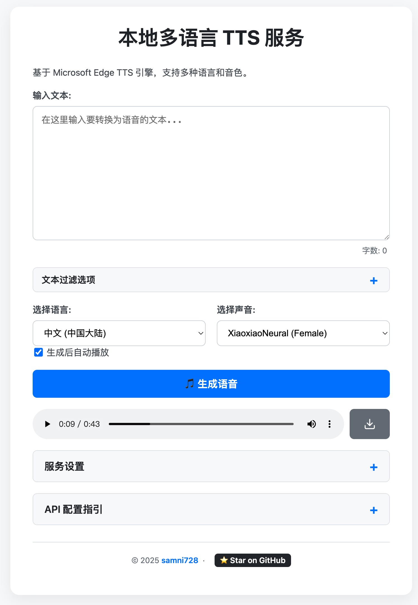
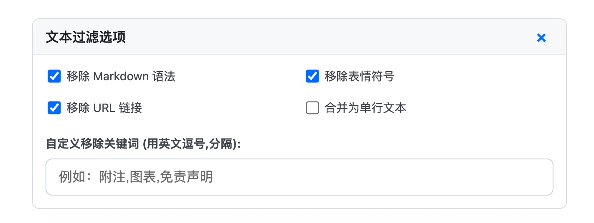
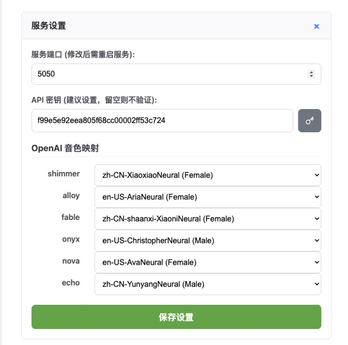
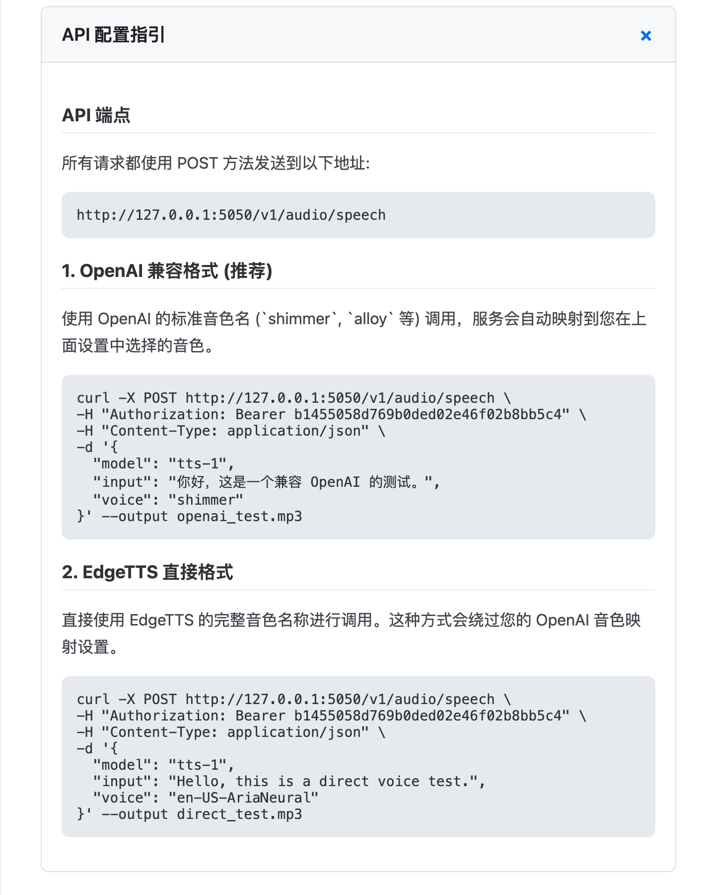

# 🚀 LocalTTS - Your private, high-performance text-to-speech service

[](https://github.com/samni728/Local-TTS-Service)

**LocalTTS** is a local TTS solution powered by the Microsoft Edge TTS engine. It is more than a tool — it is a complete, self-hostable speech center. We have optimized it heavily so that it can handle extremely long text with incredible efficiency and reliability. Whether you want to listen to a lengthy article or give your AI application a vibrant voice, LocalTTS makes it easy.



---

_For the Chinese version of this document, please see [README.zh.md](README.zh.md)._

## 🆕 Update — 2026-08-10

This release focuses on Microsoft/Azure voice capabilities, complete OpenAI-compatible voice mapping, long-form TTS reliability, and Docker/VPS compatibility.

- **Microsoft/Azure voice catalog**: imports language and capability metadata from the Azure documentation, currently recognizing 765 voices. Chinese and English are sorted first, with filters for locale/country, gender, voice type, style/emotion, and role support.
- **Complete OpenAI voice presets**: after previewing a voice in the WebUI, save its voice, style, role, style degree, speed, pitch, and text-cleaning settings directly to an OpenAI alias such as `alloy` or `shimmer`. API clients continue to send standard OpenAI requests.
- **TTS-safe cleanup and semantic chunking**: Markdown, HTML, URLs, and emojis can be removed without losing decimals, percentages, parentheses, or paragraph meaning. Long text is split at sentence, clause, and English word boundaries, while short paragraphs are coalesced to reduce unnecessary TTS calls.
- **Faster Microsoft requests**: all chunks within one API request share Microsoft endpoint data and an HTTP session, reducing endpoint lookups and TLS handshakes. Streaming output remains ordered while later chunks are synthesized concurrently in the background.
- **Cross-platform TLS and Docker/VPS support**: supports the macOS, Windows, and Ubuntu system trust stores plus private CA bundles. Docker has been verified on `linux/arm64` and `linux/amd64` and now includes health checks, sensitive-file exclusions, and safer environment variables.
- **API guide and regression tests**: the new [Edge/OpenAI extension API guide](docs/EDGE_TTS_API.md) covers styles, speed, roles, intensity, automatic voice selection, streaming, and chunk controls.

### Upgrading from an earlier release

Legacy `openai_voice_map` entries migrate automatically to the new full voice preset format. Docker-based VPS deployments must back up `config.json` before pulling and rebuild the image after updating. See [Updating an existing Docker deployment on a VPS](#updating-an-existing-docker-deployment-on-a-vps) for the complete commands.

## 🌟 Why choose LocalTTS?

We poured a great deal of effort into making LocalTTS powerful yet simple to use. It is not only functional but also reliable and pleasant to work with.

### 1. Built for long-form listening: extreme performance

We know you might want to listen to an entire ebook or a multi-page PDF. To that end we engineered unmatched performance:

- **Advanced text processing**: automatically cleans and restructures any messy text you paste in, intelligently handling line breaks and spaces for a natural flow.
- **Concurrency and fault tolerance**: industrial-grade concurrency control and retry logic ensure speech generation even for very long texts or unstable networks.
- **Blazing speed**:
  - **Lossless FFmpeg merging**: audio is stitched together using system FFmpeg, dozens of times faster than Python-only solutions.
  - **Real-world performance**: from a 30,000-word report (about 20 pages of A4) it can generate a high-quality MP3 of around 1.5 hours in just 1–2 minutes.

### 2. Made for AI applications: seamless integration with the OpenAI ecosystem

If you build AI applications, LocalTTS is the perfect local TTS alternative:

- **OpenAI API compatible**: offers an API fully compatible with OpenAI TTS (`v1/audio/speech`).
- **Drop-in replacement**: connect any tool that supports the OpenAI TTS API—`Dify`, `LobeChat`, `LM Studio`, `Jan`, etc. Simply change the API endpoint and model name to enjoy free, unlimited, censorship-free local synthesis.
- **Custom voice mapping**: use the WebUI to map standard OpenAI voices like `alloy` or `shimmer` to your favorite EdgeTTS voices for a unique AI assistant sound.

### 3. Designed for everyone: highly configurable and easy to use

Powerful features shouldn't come at the cost of usability.

- **One-click Docker deployment**: the most beginner-friendly approach, hiding all environment complexity.
- **Intuitive WebUI**:
  - **Dynamic configuration center**: set ports, concurrency, and API keys directly in the browser.
  - **Robust text filters**: remove Markdown, HTML, URLs, and emojis while preserving decimals, percentages, parenthetical meaning, and natural paragraph boundaries; custom keyword filters remain available.
    
    
- **Two layers of security**: optional WebUI login password and API key ensure your service stays secure.

See the [Edge/OpenAI extension API guide](docs/EDGE_TTS_API.md) for styles, roles, style degree, automatic voice selection, and capability discovery.

## 📖 Use cases

LocalTTS has endless possibilities; here are just a few examples:

- **Personal audiobook companion**: convert ebooks (TXT, EPUB), long web articles, or work reports (PDF) into audio so you can listen while commuting or exercising.
- **Voice-enable your AI apps**: provide a stable, free, high-quality speech backend for `Dify`, `LobeChat`, or any LangChain/LLM project.
- **Content creation helper**: quickly turn drafts into audio so you can proofread by listening.
- **Learning and accessibility tool**: a powerful reader for users with visual impairments or reading difficulties.

## 🐳 Quick start: deploy with Docker (recommended)

This is the easiest and most reliable way. **The Docker image includes FFmpeg out of the box.**

### Steps

1.  **Download the project**: `git clone https://github.com/samni728/Local-TTS-Service.git`
2.  **Create and configure the `.env` file**:
    - `cp .env.example .env`
    - Edit `.env`. **It is strongly recommended to set `WEBUI_PASSWORD`.**
    - If you are in China, uncomment `PIP_INDEX_URL` and `USE_CHINA_MIRRORS`.
3.  **Start the service**:

```bash
# First time or after updates
docker-compose up --build -d

# Normal start
docker-compose up -d
```

4.  **Access & configure**: - Visit `http://localhost:5050` (or your chosen port) in your browser. - After logging in, open **Service Settings**, set your **API key**, and save.
    

### Updating an existing Docker deployment on a VPS

`config.json` is persisted through a host bind mount. Rebuilding the image preserves API tokens, voice mappings, full OpenAI voice presets, and text-filter settings. Legacy mappings migrate automatically on first startup.

```bash
cd /path/to/Local-TTS-Service
CONFIG_BACKUP="../local-tts-config-$(date +%Y%m%d-%H%M%S).json"
cp config.json "$CONFIG_BACKUP"
git restore config.json
git pull --ff-only
cp "$CONFIG_BACKUP" config.json
docker compose config --quiet
docker compose up -d --build --remove-orphans
docker compose ps
docker compose logs --tail=100 tts-service
```

Set at least `TTS_PORT`, a strong `WEBUI_PASSWORD`, and a stable `FLASK_SECRET_KEY` in `.env`. The external port is controlled by `TTS_PORT`; the container always listens on port `5050`.

### Microsoft TLS certificate compatibility

- macOS, Windows, and Ubuntu use their operating-system trust stores by default; SSL verification stays enabled.
- A normal Ubuntu/VPS deployment needs no extra setting. Behind a private HTTPS-inspection proxy, install its root CA into the system trust store and restart the service.
- Alternatively, set `TTS_CA_BUNDLE` to a PEM CA bundle. For Docker, place it under `./certs/` and use its container path, such as `TTS_CA_BUNDLE=/app/certs/company-ca.pem`.
- If every chunk in a non-streaming request fails, the API returns HTTP `502` instead of reporting a silent file as successful.
For streaming performance tips, see [Streaming Optimization](docs/STREAMING_OPTIMIZATION.md).


## 🤝 Contributing

All kinds of contributions are welcome! If you have ideas, suggestions, or find bugs, please open an issue. If this project helps you, please give us a ⭐ on GitHub!

## 📄 License

This project is released under the [MIT License](LICENSE).
