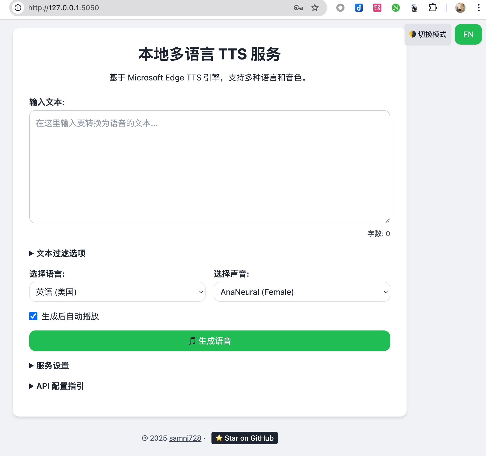
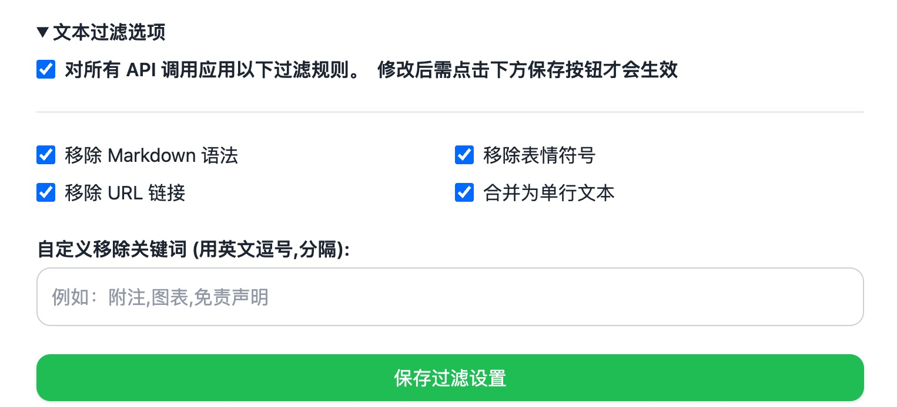
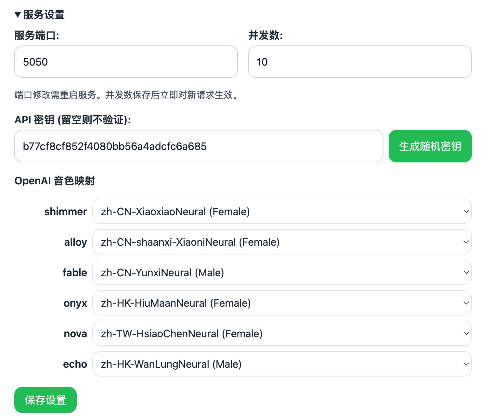
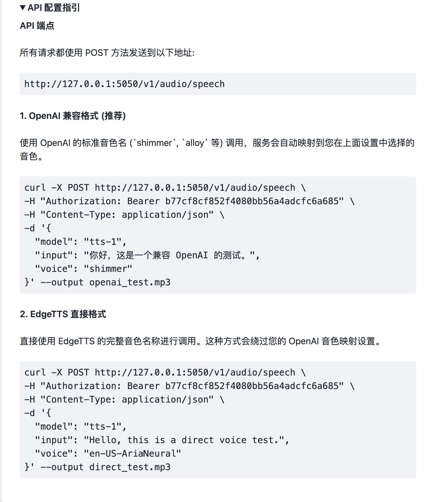

# 🚀 LocalTTS - 您私有的、高性能、高可用的语音合成服务

[](https://github.com/samni728/Local-TTS-Service)

_English version available in [README.md](README.md)._

**LocalTTS** 是一个基于 Microsoft Edge TTS 引擎的本地语音合成解决方案。它不仅仅是一个工具，更是一个**完整的、可私有化部署的语音中心**。我们对它进行了深度优化，能以惊人的效率和极高的可靠性处理超长文本，让您无论是想“听”一篇万字长文，还是为您的 AI 应用赋予动听的声音，都能轻松实现。



---

## 🆕 Update — 2026-08-10

本次更新聚焦于 Microsoft/Azure 音色能力、OpenAI 标准协议映射、长文 TTS 稳定性与 Docker/VPS 部署兼容。

- **Microsoft/Azure 音色目录**：导入 Azure 文档中的语言与音色能力，当前可识别 765 个音色；中文和英文优先排序，支持按国家/语言、性别、音色类型、情绪/风格和角色能力筛选。
- **OpenAI 音色完整预设**：在 WebUI 试听后，可将当前音色、情绪、角色、强度、语速、音调和文本清洗设置直接保存到 `alloy`、`shimmer` 等 OpenAI 标准音色。API 调用方仍只需使用 OpenAI 标准请求。
- **TTS 文本清洗与语义分块**：清理 Markdown、HTML、URL 和表情时保留小数、百分比、括号语义和段落。长文优先在句子、从句和英文单词边界分割，并合并过短段落，减少多余的 TTS 请求。
- **更快的 Microsoft TTS 请求**：同一次 API 请求内的所有文本块共用 Microsoft 端点信息与 HTTP 会话，减少额外端点请求和 TLS 握手。流式输出保持音频顺序，同时在后台并发生成后续块。
- **跨平台 TLS 和 Docker/VPS**：兼容 macOS、Windows 和 Ubuntu 系统证书库，支持私有 CA；Docker 已通过 `linux/arm64` 和 `linux/amd64` 验证，并增加健康检查、敏感文件排除和安全环境变量。
- **API 文档和测试**：新增 [Edge/OpenAI 扩展 API 文档](docs/EDGE_TTS_API.md)，覆盖情绪、语速、角色、强度、自动选音、流式输出与分块参数。

### 从旧版升级

这一版会自动将旧的 `openai_voice_map` 迁移为新的完整音色预设。使用 Docker 的 VPS 必须在拉取前备份 `config.json`，并在更新后重新构建镜像；完整命令见 [VPS 上更新现有 Docker 部署](#vps-上更新现有-docker-部署)。旧 `.env` 没有 `FLASK_SECRET_KEY` 或该值为空时，程序会自动生成固定密钥并保存到 `tts_data/.flask_secret_key`，不会再等到登录成功后才因 Session 不可用返回 HTTP 500。

## 🌟 为什么选择 LocalTTS？

我们倾注了大量心血，将 LocalTTS 打造成了一个功能强大且极易使用的服务。它不仅仅是“能用”，更是“好用”和“可靠”。

### 1. 为“听书”和长文档而生：极致性能

我们知道，您可能想用它来听一整本电子书或一份几十页的 PDF 报告。为此，我们打造了无与伦比的性能：

- **高级文本处理**: 自动净化和重组您复制粘贴的任何“脏”文本，智能处理不合理的换行和空格，确保听感流畅自然。
- **并发与容错**: 采用工业级的并发控制和重试机制，即使面对超长文本和不稳定的网络，也能最大程度保证语音的完整生成。
- **闪电般的速度**:
  - **FFmpeg 无损拼接**: 我们用系统级的 FFmpeg 进行音频拼接，速度是普通 Python 方案的数十倍。
  - **实测性能**: 处理一份 **3 万字** 的报告（约等于 20 页 A4 纸内容），生成长达 **1.5 小时**的高质量 MP3 音频，**总耗时仅需 1-2 分钟**！

### 2. 为 AI 应用而造：无缝集成 OpenAI 生态

如果您是 AI 应用的开发者，LocalTTS 将是您完美的本地 TTS 替代方案：

- **兼容 OpenAI API**: 提供与 OpenAI TTS (`v1/audio/speech`) 完全兼容的 API 接口。
- **平替方案**: 您可以将 `Dify`, `LobeChat`, `LM Studio`, `Jan` 等任何支持 OpenAI TTS 接口的 AI 应用，无缝对接到 LocalTTS。只需修改 API 地址和模型名称，即可享受**免费、不限速、无内容审查**的本地语音合成服务。
- **自定义音色映射**: 您可以通过 WebUI，将 OpenAI 的 `alloy`, `shimmer` 等标准音色，**自由映射**到您最喜欢的任何 EdgeTTS 语音上，打造独一无二的 AI 助手声音。

### 3. 为所有人而设计：强大的可配置性与易用性

我们相信，强大的功能不应以牺牲易用性为代价。

- **一键 Docker 部署**: 对新手最友好的部署方式，屏蔽所有复杂环境配置。
- **直观的 WebUI**:
  - **动态配置中心**: 在网页上即可轻松设置端口、并发数、API 密钥。
  - **强大的文本过滤器**: 一键移除 Markdown、HTML、URL、表情符号，保留小数、百分数和括号内语义，并智能合并段内软换行、保留自然段落；也可通过关键词列表进行自定义过滤。
    
    
- **双重安全保障**: 可选的 WebUI 登录密码和 API 密钥，确保您的服务在任何网络环境下都安全无虞。

详细的情绪、角色、风格强度、自动选音与 Edge 扩展参数请参阅 [Edge/OpenAI 扩展 API 文档](docs/EDGE_TTS_API.md)。

## 📖 使用场景

LocalTTS 的可能性是无限的，这里仅列举几例：

- **个人听书神器**: 将您下载的电子书（TXT, EPUB）、网上长文或工作报告（PDF）转换为有声读物，在通勤、锻炼时解放双眼。
- **AI 应用语音赋能**: 为您的 `Dify` 应用、`LobeChat` 机器人或任何基于 LangChain/LLM 的项目，提供一个稳定、免费且高质量的语音输出后端。
- **内容创作辅助**: 快速将您的文章草稿转换为音频，通过“听”的方式来校对文稿的流畅度和节奏感。
- **学习与辅助工具**: 为视力障碍者或阅读困难者提供一个强大的文本朗读工具。

## 🐳 快速开始：使用 Docker 部署 (推荐)

这是最简单、最可靠的部署方式。**Docker 方案已内置 FFmpeg，您无需任何额外安装。**

### 部署步骤

1.  **下载项目**: `git clone https://github.com/samni728/Local-TTS-Service.git`
2.  **创建并配置 `.env` 文件**:
    - `cp .env.example .env`
    - 编辑 `.env` 文件，**强烈建议设置 `WEBUI_PASSWORD`**。
    - 如果您在国内服务器，请取消 `PIP_INDEX_URL` 和 `USE_CHINA_MIRRORS` 的注释。
3.  **启动服务**:

    ```bash
    # 首次启动或更新后
    docker-compose up --build -d

    # 日常启动
    docker-compose up -d
    ```

4.  **访问与配置**: - 打开浏览器访问 `http://localhost:5050` (或您设置的端口)。 - 登录后，进入**服务设置**，设置您的**API 密钥**并保存。
    

### VPS 上更新现有 Docker 部署

推荐使用项目内置的 [`scripts/tts-vps-manager.sh`](scripts/tts-vps-manager.sh)。它会自动执行：

```text
安全预检查 → 备份私有配置 → 拉取 fast-forward 更新 → 恢复配置
→ 补齐 .env 新变量 → 重建容器 → 等待健康检查 → 失败时自动回滚
```

备份默认保存在项目同级的 `Local-TTS-Service-backups/`，包括 `config.json`、`.env`、自动生成的 Flask Session 密钥、自定义 CA 证书和更新前 Git commit。备份目录权限会限制为当前用户访问。

#### 第一次：不执行 git pull，直接下载最新脚本

把下面的项目路径换成 VPS 上的实际路径：

```bash
curl -fsSL \
  https://raw.githubusercontent.com/samni728/Local-TTS-Service/main/scripts/tts-vps-manager.sh \
  -o /tmp/tts-vps-manager.sh

bash /tmp/tts-vps-manager.sh update \
  --repo /path/to/Local-TTS-Service
```

确认脚本来源后，也可以直接粘贴一条命令运行：

```bash
curl -fsSL https://raw.githubusercontent.com/samni728/Local-TTS-Service/main/scripts/tts-vps-manager.sh \
  | bash -s -- update --repo /path/to/Local-TTS-Service
```

这条方式适合旧仓库中的 `config.json` 已被 WebUI 修改、直接 `git pull` 可能冲突的情况。脚本会先备份并处理冲突，不需要提前拉取新版代码。

#### 后续：直接使用仓库中的脚本

```bash
cd /path/to/Local-TTS-Service
./scripts/tts-vps-manager.sh update
```

常用运维命令：

```bash
# 只备份，不更新
./scripts/tts-vps-manager.sh backup

# 查看已有备份
./scripts/tts-vps-manager.sh list

# 查看当前 Git 版本和容器状态
./scripts/tts-vps-manager.sh status

# 恢复最近一次备份，并重新构建容器
./scripts/tts-vps-manager.sh restore latest

# 恢复指定备份
./scripts/tts-vps-manager.sh restore 20260810-120000-pre-update-1234
```

如果项目不在脚本自动识别的位置，所有命令都可以增加 `--repo /实际路径`。也可以用 `--backup-dir /安全备份路径` 指定统一备份目录。脚本遇到 `config.json` 之外的未提交代码修改时会停止，不会用 `git reset` 覆盖你的开发代码。

#### 手动更新流程（脚本不可用时）

`config.json` 通过宿主机绑定挂载持久化，已有 API 密钥、音色映射、完整 OpenAI 音色预设和文本过滤设置不会因重新构建镜像而丢失。旧版映射会在首次启动时自动迁移。

```bash
cd /path/to/Local-TTS-Service

# config.json 当前是 Git 跟踪文件，先把 VPS 运行配置备份到仓库外
CONFIG_BACKUP="../local-tts-config-$(date +%Y%m%d-%H%M%S).json"
cp config.json "$CONFIG_BACKUP"

# 恢复仓库版本后再拉取，避免 WebUI 写入的配置阻塞 git pull
git restore config.json
git pull --ff-only
cp "$CONFIG_BACKUP" config.json

# 不显示密码或 Token，只列出新版 .env.example 中新增但本机缺少的变量名
[ -f .env ] || cp .env.example .env
for key in $(grep -E '^[A-Z0-9_]+=' .env.example | cut -d= -f1); do
  grep -q "^${key}=" .env || echo "缺少环境变量：${key}"
done

docker compose config --quiet
docker compose up -d --build --remove-orphans
docker compose ps
docker compose logs --tail=100 tts-service
```

建议在 `.env` 中至少设置：

```dotenv
TTS_PORT=5050
WEBUI_PASSWORD=请替换为强密码
FLASK_SECRET_KEY=请使用-openssl-rand-hex-32-生成的固定值
```

- `TTS_PORT` 是 VPS 对外端口；容器内部固定使用 `5050`，不会再受 WebUI 端口配置影响。
- `FLASK_SECRET_KEY` 仍建议在生产环境显式设置；如果旧 `.env` 没有该变量或值为空，程序会自动生成 64 位十六进制密钥并保存到 `tts_data/.flask_secret_key`。该目录已由 Docker 挂载持久化，因此重建镜像和重启容器不会轮换 Session 密钥。
- 如果无法写入持久化密钥文件，服务仍能启动，但日志会明确警告正在使用内存密钥；这种情况下容器重启会使已有登录 Session 失效。
- 国内 VPS 如果 Debian 软件源较慢，可以设置 `USE_CHINA_MIRRORS=true` 后重新构建。
- `config.json` 当前仍由 Git 跟踪，因此 VPS 更新必须按上面流程先备份再恢复；不要直接在有本地配置改动时强行拉取。
- 不要使用 `docker compose down -v` 清理数据。当前使用绑定挂载，但更新前保留仓库外备份仍是推荐做法。
- 更新后若健康状态不是 `healthy`，先运行 `docker compose logs --tail=200 tts-service` 检查日志。

### Microsoft TLS 证书兼容性

- macOS、Windows 和 Ubuntu 默认使用各自的系统信任库，不需要关闭 SSL 校验。
- Ubuntu/VPS 使用标准公网网络时无需额外配置；如服务器经过企业 HTTPS 代理，请把代理根证书安装到系统 CA 后重启服务。
- 也可以设置 `TTS_CA_BUNDLE` 指向 PEM 格式的 CA 文件。Docker 部署时将证书放入 `./certs/`，并在 `.env` 中使用容器路径，例如 `TTS_CA_BUNDLE=/app/certs/company-ca.pem`。
- 非流式请求如果所有分块均生成失败，接口会返回 HTTP `502`，不会再把静音文件作为成功结果返回。

## 🤝 贡献

欢迎任何形式的贡献！如果您有任何想法、建议或发现 Bug，请随时提交一个 Issue。如果这个项目对您有帮助，请在 GitHub 上给我们一颗 ⭐ Star！

## 📄 许可

本项目采用 [MIT 许可证](LICENSE)。
